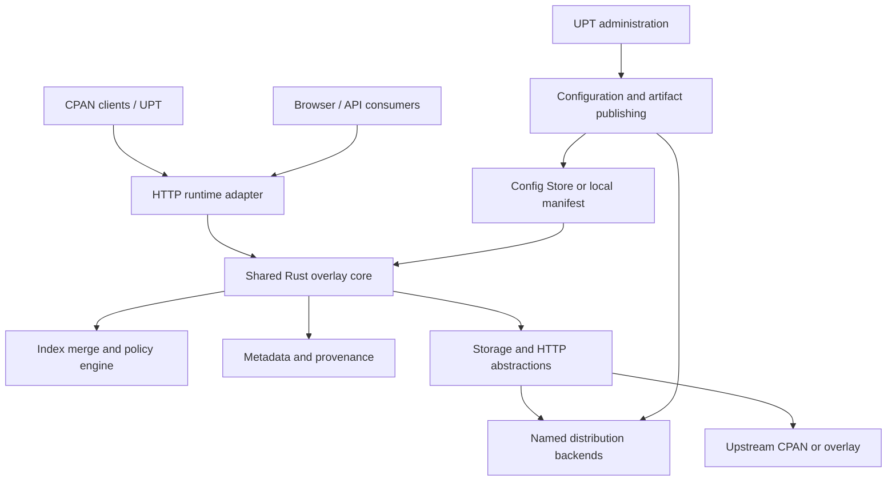

# CPAN Overlay — Design Document

**Project:** `cpan-overlay`  
**Proposed repository:** `uperl/cpan-overlay`  
**Status:** Draft / proposed architecture  
**Date:** 2026-11-26

## 1. Overview

CPAN Overlay is a lightweight, composable CPAN mirror overlay that publishes personal or internal Perl distributions and replaces selected upstream distributions with patched releases. It presents a conventional CPAN mirror interface, while delegating unmodified distributions to an upstream mirror. It additionally exposes a human-readable website and a machine-readable API describing every deliberate deviation from upstream.

The flagship deployment target is Fastly Compute. The same implementation must also run locally using Viceroy and, ultimately, as a native standalone HTTP service suitable for a LAN. All first-party application and administration code is written in Rust. Administrative functionality belongs in UPT (Unified Perl Tool), the existing Rust-based project in the `uperl` GitHub organization, rather than in a new standalone Perl utility.

The motivating use cases are a personal, publicly accessible collection of distributions and curated fixes, and an equivalent independently configured service for an organization. Personal distributions need not be confidential; authentication is optional, not a prerequisite for deployment.

## 2. Goals and non-goals

### Goals

- Add distributions and packages that are absent from public CPAN.
- Override packages from upstream with intentionally patched distributions, including fixes that upstream maintainers have declined or not yet incorporated.
- Preserve ordinary CPAN client compatibility without requiring client modifications or UPT.
- Support configurable proxying and redirects for HTTP distribution backends.
- Support multiple named distribution backends in a single instance.
- Use Fastly Config Store for hosted configuration, with equivalent portable local configuration.
- Provide optional authentication and transparent patch provenance.
- Provide a usable human-facing site with client configuration instructions, and a versioned read-only JSON API.
- Support independent home, work, and experimental LAN instances, including overlays chained on top of other overlays.
- Require no installed Perl interpreter for the server or administrative tooling. Installing a Perl distribution may naturally require a target Perl and its build tools; that is distinct from running the overlay or bootstrapping UPT.

### Non-goals

- Replicating all of CPAN or implementing PAUSE uploads, author accounts, or the full MetaCPAN service.
- Building a multi-tenant artifact management platform, mandatory control plane, or separate administrative CLI.
- Automatically deciding that a newer upstream version fixes a patched bug.
- Rewriting an upstream tarball at its original immutable public path.
- Guaranteeing offline installation of arbitrary distributions without prefetching their dependency closure.
- Requiring Fastly, UPT, or any specific storage vendor in every deployment.

## 3. Architecture



The core is independent of the transport runtime. Runtime adapters supply configuration, storage, upstream HTTP, caching, clock, logging, and request/response translation. Avoid native-only dependencies in the core and avoid leaking Fastly SDK types into public core interfaces. Choose synchronous/asynchronous boundaries after verifying SDK constraints; do not require Tokio in the Wasm target.

### 3.1 Proposed repository layout

```text
cpan-overlay/
  Cargo.toml
  crates/
    cpan-overlay-core/
    cpan-overlay-compute/
    cpan-overlay-server/
  templates/
  schemas/
  tests/
    fixtures/
    interoperability/
  examples/
    fastly/
    viceroy/
    standalone/
  fastly.toml
  docs/
```

These are provisional crate names, not commitments to publish every crate independently. UPT remains a separate repository. Review its existing code before deciding where shared CPAN libraries live; use one canonical implementation for shared semantics rather than introducing circular dependencies.

### 3.2 Deployment targets

| Capability | Fastly Compute | Viceroy | Native standalone |
|---|---|---|---|
| Runtime | Rust/Wasm | Same Compute artifact | Native Rust binary |
| Configuration | Config Store | Emulated Config Store | Local JSON/TOML |
| Secret material | Secret Store | Local test secret fixture | Secret file/environment |
| Artifact backends | HTTP, KV | HTTP, emulated KV | HTTP, filesystem |
| Cache | Fastly cache | Emulator-supported facilities | Memory/disk |
| TLS | Managed edge TLS | Local test configuration | Reverse proxy or native TLS |
| Logging | Configured log endpoints | Local logs | Structured stdout/stderr |

Viceroy is the first local target and a useful development and interoperability environment; it is not assumed to be a supported production server. Native HTTP serving is a first-class target for permanent LAN installations. Axum/Tokio are candidate native libraries, not requirements. Local deployments must not require Fastly credentials or network access to Fastly.

## 4. CPAN compatibility contract

The service is an overlay on the conventional CPAN mirror namespace, not a package installation protocol of its own.

| Path | Behavior |
|---|---|
| `/modules/02packages.details.txt.gz` | Generate and serve merged package index |
| `/authors/id/<author-path>/<archive>` | Serve overlay artifact if explicitly mapped; otherwise delegate upstream |
| `/authors/id/<author-path>/CHECKSUMS` | Serve appropriate checksum metadata for locally managed author paths; otherwise delegate upstream |
| `/authors/01mailrc.txt.gz` | Delegate upstream; optionally merge private author metadata if compatibility requires it |
| Other conventional mirror paths | Delegate upstream, except reserved local API/UI paths |
| `/` and documented UI routes | Human-readable website |
| `/api/v1/...` | Read-only inspection API |

GET and HEAD are supported on mirror resources. Preserve meaningful status codes, content lengths/types, conditional requests and range requests where supported; document exceptions. Do not turn missing resources into HTML success responses. Reject unsafe paths and unsupported methods. Unknown paths within a reserved local author namespace should return 404 rather than falling through unexpectedly.

Investigate other index files (`03modlist.data.gz`, author metadata, RECENT files, signatures, alternate compressed/uncompressed indexes) against real clients. Do not silently claim that upstream ancillary metadata accurately describes a modified index. Explicitly document unsupported endpoints or stale inherited metadata. This is not a full PAUSE-compatible mirror.

## 5. Index construction and override semantics

Fetch the upstream `02packages.details.txt.gz`, decompress with bounded resources, parse the header and package rows, and merge the active overlay manifest. A row associates a package name, version (possibly `undef`), and distribution path. Preserve valid upstream semantics, including unusual versions, rather than interpreting Perl versions as SemVer.

1. Obtain a validated configuration snapshot and upstream index snapshot.
2. Determine active distribution entries and their exact package claims.
3. Apply explicitly configured package removals/replacements/additions.
4. Reject ambiguous claims by multiple active local entries; never rely on manifest ordering to resolve accidental conflicts.
5. Sort deterministically by package name, regenerate accurate header fields and line count, and emit a valid gzip stream.
6. Publish/cache the index as one coherent generation with its routing and provenance metadata.

A distribution can provide multiple packages. Overriding only its principal package may cause other packages to resolve to the original archive, or introduce mixed versions in a dependency graph. Default to replacing the complete package set of a patched release after comparison with its upstream package set. Explicitly represent removed or intentionally unindexed packages, and fail validation on unexplained omissions. Never remove packages belonging to unrelated upstream distributions merely because of a similar name. New personal distributions that collide with upstream package names must be explicitly marked as overrides rather than silently shadowing them.

### 5.1 Policies

| Policy | Meaning |
|---|---|
| `private` | Publish a personal/internal distribution; reject unexpected upstream collisions |
| `force` | Prefer the configured patched release even when upstream publishes a newer release |
| `until-newer` | Disable the override once a strictly newer upstream version than the patch's base is detected (opt-in) |
| `exact-upstream` | Apply only when the relevant upstream path/release matches the declared base |

Default patches to `force`. A newer release is not evidence that the bug is fixed. Display stale or inapplicable overrides explicitly in the API and UI. Conditional policies require defined behavior for missing or incomparable versions: retain the last valid decision or fail validation rather than silently dropping a fix. Multi-package version comparisons and upstream distribution identification require research and test fixtures. The proposed `until-newer` comparison is against the upstream base, not necessarily the custom version string.

### 5.2 Artifact identity and versions

Use a separate, configurable overlay author namespace, e.g. `L/LO/LOCAL/Foo-Bar-1.24.1.tar.gz`. Reserve it locally and detect collisions with the upstream author/path namespace. A real overlay owner may select a different, unique namespace. Keep the original distribution accessible through its original path.

Artifact paths are immutable: never publish different bytes at a previously published path. Use content digests and unique release paths; preserve historical artifacts long enough for lockfiles and rollback. Package versions in the index must reflect the actual distribution contents. Merely increasing a tarball filename does not increase `$VERSION`. Choose patched versions with awareness of CPAN version semantics, dependency constraints, and clients that skip installation when a matching version is already installed. Some patches may intentionally retain package versions; document that a reinstall may then be needed. Do not imply that every client can infer patch identity from version alone.

Generate compatible `CHECKSUMS` metadata for overlay paths, including SHA-256 where applicable. Determine the precise conventional format and client expectations via fixtures. Do not copy upstream signatures onto modified archives or claim PAUSE signatures for local artifacts. Preserve upstream licensing, notices and source provenance when redistributing patches.

## 6. Configuration and storage

Configuration is versioned, validated and portable. The following illustrative JSON is a logical manifest, not a finalized schema or literal Fastly resource declaration:

```json
{
  "schema_version": 1,
  "site": {
    "title": "Personal CPAN Overlay",
    "description": "Personal Perl distributions and curated patches",
    "public_url": "https://cpan.example.com"
  },
  "authentication": {"mode": "none"},
  "upstream": {"backend": "cpan"},
  "backends": {
    "cpan": {"type": "http", "base_url": "https://cpan.metacpan.org", "delivery": "proxy"},
    "github": {"type": "http", "base_url": "https://github.com", "delivery": "redirect"},
    "local-kv": {"type": "kv", "store": "distributions"}
  },
  "distributions": [
    {
      "name": "Foo-Bar",
      "kind": "patched",
      "version": "1.24.1",
      "path": "L/LO/LOCAL/Foo-Bar-1.24.1.tar.gz",
      "backend": "github",
      "object": "example/foo/releases/download/v1.24.1/Foo-Bar-1.24.1.tar.gz",
      "provides": {"Foo::Bar": "1.24.1", "Foo::Bar::Util": "1.24.1"},
      "policy": "force",
      "upstream": {"path": "A/AU/AUTHOR/Foo-Bar-1.24.tar.gz", "version": "1.24"},
      "patches": [
        {"summary": "Fix Perl 5.42 compatibility", "issue_url": "https://github.com/example/foo/issues/42", "patch_url": "https://github.com/example/foo/commit/abc123.patch"}
      ],
      "source": {"repository": "https://github.com/example/foo", "revision": "abc123"}
    },
    {
      "name": "Personal-Tools",
      "kind": "personal",
      "version": "0.01",
      "path": "L/LO/LOCAL/Personal-Tools-0.01.tar.gz",
      "backend": "local-kv",
      "object": "Personal-Tools-0.01.tar.gz",
      "provides": {"Personal::Tools": "0.01"},
      "policy": "private"
    }
  ]
}
```

Production records also carry artifact SHA-256, byte size, timestamps, licensing information where known, and upstream digest when available. Example URLs and revisions are fictional placeholders.

Fastly Config Store is the authoritative hosted configuration source. Do not assume the entire manifest fits into a single entry. Evaluate current entry, store and propagation limits. Use versioned immutable manifest shards or a manifest object in KV/HTTP referenced by an active Config Store generation pointer if necessary. Distinguish linked Fastly resources from logical backend names; provisioning/linking a new backend may require platform setup even when adding a distribution to an existing backend does not. Never store passwords, tokens or private keys in the public manifest.

Local configuration supports JSON and optionally TOML mapped to the same typed schema. Filesystem backends specify a root directory; canonicalize paths and prevent traversal/symlink escape. Prefer atomic configuration replacement and validation before activating a change. Unknown schema versions fail clearly.

### 6.1 Backend interface

- HTTP: public CPAN mirrors, GitHub release assets, generic HTTP repositories, S3-compatible HTTP origins and other overlays. Authenticated HTTP/object-storage access may require signing or adapter-specific credentials; do not assume arbitrary private S3 buckets work with an unsigned GET.
- KV: artifact retrieval via named linked store and object key; verify current Fastly size and resource limits.
- Filesystem: native local artifact directories.

Backends implement metadata lookup and byte streaming where possible. An HTTP backend may support redirects; KV and filesystem normally serve bytes directly. Artifact names are independent of storage location. Do not expose internal storage URLs, keys, credentials or presigned URLs in the public provenance API by default.

## 7. Proxying versus redirects

HTTP delivery is configurable per backend, with optional per-distribution override considered later. Default to proxy for maximum compatibility. Redirect mode returns a temporary HTTP 302 to an explicitly configured public artifact URL. A redirect changes delivery, not artifact identity or index path. Avoid permanent redirects so backend locations remain changeable.

Proxying handles unreachable LAN/internal backends, backend-only credentials, and clients unable to follow redirects. Stream responses rather than buffering large archives unnecessarily. Follow upstream redirects only under an explicit bounded policy. Do not forward client authorization headers to unrelated origins; backend authentication is independently resolved. Validate destination scheme and allowed hosts, including redirect targets. Avoid TLS downgrade by default and prevent open redirects/SSRF. Strip hop-by-hop headers and do not cache user-specific or unauthorized responses as public content. Authenticated or confidential artifacts should generally be proxied; redirect only when the target independently enforces appropriate access or an explicitly authorized short-lived URL is intended.

### 7.1 Interoperability research

Ordinary GET redirects are expected to work with many modern clients, but no end-to-end compatibility result has yet been established. CPAN clients can select different download implementations; testing only one installation is inadequate.

| Client | Preliminary expectation / test scope |
|---|---|
| cpanm | Likely supports 302; independently test LWP, HTTP::Tiny, wget and curl paths where supported by the tested version |
| CPAN.pm | Likely on modern configurations; test HTTP implementation and older releases |
| Carton | Likely via its installer stack; verify actual locked and unlocked installs |
| Carmel | Investigate |
| CPANPLUS | Investigate |
| UPT | Review current implementation; fix and test redirect support as necessary |

Build a controlled HTTP fixture server and test direct/proxy/302 downloads, relative and absolute Location, cross-origin and multi-hop redirects, redirect loops, HTTP-to-HTTPS, TLS errors, HEAD, checksum verification, authentication leakage, GitHub release assets, retries, old client versions, and package installation from a real merged index. Test dependency resolution, lockfiles, already-installed upstream versions and fallback to public metadata. External Perl interpreters and clients are permitted in interoperability tests; no production overlay or UPT runtime dependency on Perl is introduced.

Publish a versioned compatibility matrix distinguishing observed results from expectations. If necessary, recommend proxy mode for particular clients. Do not assert universal redirect support until tested.

## 8. Cache, consistency and failure behavior

Cache upstream indexes using validators and configurable freshness. Cache the merged index by upstream snapshot identity plus configuration generation and format version. Recompute only on a change or cache miss, with request coalescing where available. Generate deterministic content and ETags. Use separate artifact caches keyed by immutable path/digest and appropriate authorization scope. Honor conditional requests and avoid unnecessary recompression.

Fastly Compute has finite CPU, memory, execution and cache limits. Benchmark real full CPAN indexes (compressed and decompressed), parsing, merging, sorting and gzip generation, with realistic overlay sizes. Measure cold/warm requests and concurrent misses. If on-demand generation exceeds limits, support precomputed merged indexes generated by Rust tooling and published to a configured artifact backend; arrange periodic upstream refresh via deployment automation or a supported scheduler. No persistent Compute instance or assumed background execution is required. This fallback is an explicit design option, not a claim about current platform limits.

Publish artifacts and checksums before activating a new manifest. Retain old paths during propagation so an older index remains installable. Activate versioned metadata using a single pointer where practical, purge or version cache keys, and allow rollback by selecting an earlier generation. Fastly propagation may be eventually consistent across locations; do not promise global atomicity. Validate configuration and preserve the last known good index where supported. Surface errors and stale state in status/API; never silently fall back to unpatched CPAN when configured overrides cannot be loaded. If no valid snapshot is available, return a useful 503 instead of an incorrect index. A failing custom artifact backend must not silently substitute original upstream bytes.

### 8.1 LAN cache and composable overlays

A native deployment may optionally retain upstream archives on disk and operate in a cache-only/offline mode using the last valid index. Offline indexes may reference uncached artifacts; report missing artifacts clearly and consider a separate prefetch workflow. Apply disk quotas/eviction while preserving explicitly published custom artifacts.

An overlay can use another overlay as its upstream:

```text
LAN clients -> local experimental overlay -> hosted personal overlay -> public CPAN
```

Nearest explicit override wins. Preserve inherited provenance when the upstream exposes a compatible API, distinguish inherited and local patches, and report unavailable upstream provenance as unknown. Define conflict behavior and prevent recursion using deployment identifiers, bounded hops and loop detection where supported. No assumption that arbitrary CPAN mirrors implement the overlay API.

## 9. Security and deployment isolation

Public access is the default because personal distributions need not be secret. Optional service-wide authentication supports HTTP Basic (candidate for broad client compatibility) and bearer tokens (candidate for UPT/automation). Verify each supported client and document its configuration. Use TLS for authenticated deployments; do not publish credentials in example commands, URLs, UI, or logs. Store secrets in Fastly Secret Store or secure local equivalents; compare credentials safely, rotate them and keep backend credentials separate.

Enforce access before serving cached private responses, including index, tarballs, checksums, UI, API and health information. Return appropriate 401 challenges and 403 responses. Cache only within appropriate access boundaries. Authentication on an overlay cannot make independently public GitHub artifacts confidential. Protect configuration updates using Fastly management authorization or local OS permissions. The first release exposes no public write API. Sanitize HTML/Markdown, escape metadata, bound archive parsing and decompression, reject unsafe paths and untrusted destinations, and avoid executing distribution build scripts during metadata inspection. Use independently scoped home/work credentials and configuration; no shared tenant database or cross-instance secrets.

## 10. Public inspection API

Expose a versioned, read-only JSON API. Its data comes from the same effective snapshot as the merged index; do not independently compute policies in the UI or API. Include a generation identifier and upstream snapshot timestamp so clients can correlate responses. Use normal HTTP status codes, documented schemas, deterministic ordering and pagination for potentially large responses. Keep raw package-index paths out of the API routing namespace; encode package names as URL components.

| Endpoint (GET) | Purpose |
|---|---|
| `/api/v1/overlay` | Identity, description, upstream, generation, counts and capabilities |
| `/api/v1/distributions` | Personal and patched distributions, with active/inactive status |
| `/api/v1/distributions/{name}` | Detailed metadata, version, artifact path and provenance |
| `/api/v1/patches` | Patch descriptions and override policy, including inactive overrides |
| `/api/v1/packages/{package}` | Effective package resolution and origin (local, inherited or upstream) |
| `/api/v1/index/diff` | Exact package additions, replacements and removals relative to immediate upstream |
| `/api/v1/upstream` | Upstream identity, index freshness, last fetch and comparison status |
| `/api/v1/status` | Service readiness, generation and appropriately redacted backend health |

Distribution responses distinguish declared overrides from effective overrides. Include the original upstream version/path and link, patch version/path and download link, the affected package list, human-readable reasons, patch/source references, optional issue and pull request links, source revision, checksums and relevant history. An upstream release newer than the patch base is reported as such, not labeled a confirmed fix. The absence of a diff link is explicitly representable; provenance can be descriptive when no source patch URL is available.

Illustrative response:

```json
{
  "name": "Foo-Bar",
  "kind": "patched",
  "active": true,
  "policy": "force",
  "version": "1.24.1",
  "path": "L/LO/LOCAL/Foo-Bar-1.24.1.tar.gz",
  "upstream": {
    "version": "1.24",
    "path": "A/AU/AUTHOR/Foo-Bar-1.24.tar.gz",
    "newer_release_available": false
  },
  "provides": {"Foo::Bar": "1.24.1", "Foo::Bar::Util": "1.24.1"},
  "patches": [
    {
      "summary": "Fix Perl 5.42 compatibility",
      "issue_url": "https://github.com/example/foo/issues/42",
      "patch_url": "https://github.com/example/foo/commit/abc123.patch"
    }
  ],
  "source": {"repository": "https://github.com/example/foo", "revision": "abc123"}
}
```

The API should be discoverable from the homepage and documented with examples and, preferably, a machine-readable OpenAPI description. Authentication follows the same access policy as the mirror. Redact internal hostnames and resource identifiers when their disclosure is unnecessary. The API does not expose credentials or administrative operations.

## 11. Human-facing website

Generate HTML using Rust and the effective configuration/index snapshot. Keep it fast, readable, responsive and accessible with no required JavaScript or external frontend build system. Small progressive-enhancement features such as copying commands or filtering lists are acceptable. Use server-side escaping and safe URL generation; sanitize optional owner-supplied Markdown.

| Page | Content |
|---|---|
| `/` | Instance description, upstream status, installation instructions, patched and personal distribution summaries |
| `/configure` | Detailed client configuration, temporary/persistent examples, authentication and reset instructions |
| `/distributions` | Filterable or paginated custom distribution list |
| `/distributions/{name}` | Versions, provided packages, policy, source, patch provenance, hashes and download links |
| `/patches` | Explicit comparison with upstream, reasons and links to original releases |
| `/status` | Index freshness and safe health information |
| `/api` | API documentation and links |

The homepage should make it immediately apparent that this is an overlay, not public CPAN itself. Display counts of active patched and personal distributions, the upstream mirror, and visible warnings for stale index data or newer upstream releases. Include configurable instance branding and a link to project source. For small overlays, show the entire custom distribution list; paginate or filter larger deployments.

### 11.1 Client configuration instructions

Generate instructions from a configured canonical `site.public_url`, rather than blindly trusting incoming Host headers. Include a simple one-off install example and persistent setup where supported. Show how to switch back to the previous configuration. Explain that some clients consult external metadata services and may bypass the overlay unless configured to use only the mirror. Do not promise identical semantics across every client or silently modify a user's environment.

Examples for a public deployment at `https://cpan.example.com`:

```sh
# cpanm: one-off installation
cpanm --mirror https://cpan.example.com --mirror-only Foo::Bar

# cpanm: persistent shell configuration (preserve other desired options)
export PERL_CPANM_OPT="--mirror https://cpan.example.com --mirror-only"
```

For the CPAN.pm interactive shell, candidate commands are:

```text
cpan> o conf urllist https://cpan.example.com
cpan> o conf commit
```

Verify exact commands and mirror-only behavior for supported client versions before publishing generated instructions. Include UPT instructions based on its actual interface; add tested instructions for Carton, Carmel and CPANPLUS where appropriate. Explain lockfile behavior, refreshing cached indexes, and reinstalling patched packages with unchanged versions. For authenticated instances, use verified credential configuration mechanisms rather than embedding secrets in displayed commands. For LAN installations, display the configured LAN address and distinguish plaintext HTTP from HTTPS.

## 12. UPT integration

UPT (Unified Perl Tool) is an existing Rust-based project under the `uperl` GitHub organization. Its purpose includes bootstrapping Perl on a system without a Perl installation, installing Perl distributions, replacing cpanm functionality and eventually unifying other Perl tooling. The overlay complements this mission without requiring UPT to operate.

### 12.1 UPT as consumer

- Support ordinary mirror configuration pointing to an overlay, including mirror-only resolution where applicable.
- Verify redirects, proxy responses, checksum handling, authentication and local HTTP support.
- Allow installation of a Perl environment and modules with an overlay configured from the outset.
- Consider optional provenance inspection when the mirror advertises the overlay API, without requiring that API for ordinary CPAN mirrors.

### 12.2 UPT as administrator

Integrate administrative commands into UPT; do not create another standalone administrative program. The following command spelling is illustrative and must be reconciled with the current UPT CLI conventions:

```sh
upt overlay list
upt overlay status
upt overlay add Foo-Bar-1.24.1.tar.gz
upt overlay patch Foo-Bar
upt overlay remove Foo-Bar
upt overlay outdated
upt overlay diff
upt overlay validate
upt overlay publish
upt overlay --profile home list
upt overlay --profile work outdated
upt overlay promote Foo-Bar --from local --to home
```

Support named profiles for independent instances. Each profile describes the service URL, management target, backend defaults and credential references. Do not store plaintext production credentials in shared project configuration. Explicitly select a target for sensitive publishing operations and show a dry-run plan before changes where appropriate. A profile for local files should need no Fastly credentials.

UPT inspects distributions without executing Perl code, computes digests, resolves provided packages, compares against the upstream base, gathers patch provenance, validates paths, and generates metadata/checksums. Prefer `META.json` and support legacy `META.yml`. Metadata may be incomplete or inaccurate; define conservative static inspection rules, allow explicit package/version declarations, validate them, and report uncertainty. Do not attempt arbitrary evaluation of Perl `$VERSION` expressions. Test Perl version semantics, including decimal versions, v-strings, developer releases and `undef`.

Publishing is an explicit staged operation: inspect and validate; stage immutable artifact bytes and associated checksums; stage the new configuration generation; activate it; invalidate or version caches; verify index, artifact and API responses. Fail before activation if required artifacts are unavailable. Report partial failures and recovery steps. Rollback selects a retained generation; deletion of old artifacts is a separate operation with retention checks. Removing an override removes it from the effective index, not necessarily from storage.

For GitHub release or other HTTP backends, UPT may register an already published immutable artifact rather than upload it. A future GitHub Actions workflow can invoke UPT to publish automatically. Publishing should be scriptable and idempotent. Promotion copies or references artifacts and associated provenance between explicitly selected instances, subject to destination access and validation; avoid accidentally publishing confidential work artifacts to a public instance.

### 12.3 Shared Rust code

Review the existing UPT repository before finalizing crate boundaries. Candidate shared components are CPAN index parsing, Perl version comparison, metadata deserialization, archive inspection, path handling and checksum support. Determine whether these should live in existing UPT libraries or separate `uperl` crates. Keep shared code runtime-neutral where practical. No Perl implementation is required or proposed for either project. The existing Perl ecosystem is a behavioral reference and interoperability target, not a required implementation substrate.

## 13. Testing and acceptance criteria

- Unit tests: index parser, deterministic merge, header accuracy, package claims/conflicts, policy activation, version ordering, path safety, checksum generation and schema validation.
- Golden fixtures: real representative CPAN index rows, malformed input, distributions with multiple packages, missing metadata, removed packages, unusual versions and duplicate claims.
- Backend contract tests: HTTP direct/redirect/proxy, KV and filesystem, missing objects, large objects, auth, timeouts and immutable identity.
- Runtime integration: identical fixture results on native Rust and Viceroy; deployment smoke tests on Fastly Compute; resource benchmarking against representative full indexes.
- Client interoperability: matrix in section 7.1, including actual module installs and dependency resolution with and without lockfiles.
- Security: credentials never leaked across redirects, traversal/SSRF protections, authentication before cache access, cache isolation, HTML escaping, bounded parsing, safe error disclosure.
- Operational: invalid configuration, partial publication, upstream failure, last-known-good recovery, generation rollback, cache invalidation, and chained overlay behavior.
- UI/API: consistent effective snapshot, accurate provenance, generated client instructions, accessibility and authentication modes.

Minimum viable service acceptance: a conventional CPAN client can install an unchanged upstream distribution, a personal distribution, and a patched distribution from the same mirror; all resolve to the expected bytes. The merged index is valid and the website/API explain the patch. The same manifest semantics are exercised in Viceroy and on Fastly. A configuration change using an existing backend does not require a new application build. Native deployment acceptance additionally requires operation on a LAN without any Fastly account or installed Perl, using local configuration and filesystem/HTTP storage.

## 14. Implementation milestones

1. **Research and foundation:** review UPT and App::opan; confirm CPAN mirror protocol and version semantics; establish Rust workspace, configuration schema, sample fixtures and runtime abstractions; benchmark index processing early.
2. **Compute MVP:** Config Store manifest, upstream retrieval, merged index, immutable custom paths, HTTP proxying and redirects, KV support, caching and checksum endpoints; test locally with Viceroy and on Fastly.
3. **Transparency and security:** human UI, generated client configuration, JSON API, patch provenance, optional authentication, compatibility tests and deployment documentation.
4. **UPT integration:** reusable Rust components, consumer compatibility, named profiles, validation and staged publication commands. Coordinate as separate work in the UPT repository; do not block basic server operation on CLI completion.
5. **Native server:** portable config loading, filesystem and HTTP backends, native cache, LAN binding, operational logging, parity testing and local deployment documentation.
6. **Extensions:** chained overlays, inherited provenance, persistent/offline cache and promotion workflows. Prioritize based on actual home/work use.

These milestones are proposed sequencing, not release commitments. Design runtime boundaries from the first milestone even if only one adapter is implemented initially.

## 15. Open research and decisions

| Question | Proposed resolution / exit criterion |
|---|---|
| Compute index generation limits | Benchmark current SDK/platform with actual CPAN indexes; adopt precompute fallback if needed |
| Config Store and KV limits, propagation | Verify current documented limits and test manifest activation; select storage and shard strategy |
| UPT existing architecture | Inspect repository and identify reusable Rust components and CLI conventions |
| CPAN redirects | Run section 7 matrix and publish observed compatibility results |
| CPAN checksum/index details | Confirm formats and required ancillary endpoints with real clients |
| Patched version semantics | Test package versions, developer versions, same-version reinstalls and lockfiles |
| Metadata extraction | Define safe fallback for missing `provides` and dynamic versions without running Perl |
| HTTP backend mechanics | Validate static/dynamic Fastly backend configuration, TLS/Host handling, redirects and origin auth |
| Cache consistency | Test last-known-good behavior, activation propagation and old artifact availability |
| Chained overlay precedence | Formalize inherited API provenance and loop detection |
| Authentication | Verify CPAN client credential mechanisms; select supported modes and documentation |
| Naming and distribution | Confirm crates.io availability before publishing; decide licensing and release conventions |

## 16. Prior art and references

### App::opan — Matt S. Trout

- [MetaCPAN documentation and distribution source links](https://metacpan.org/pod/App::opan)

App::opan is an earlier Perl-based CPAN overlay for private distributions and version pinning. It is directly relevant prior art. Review its index-merging logic, multi-package handling, pinning and replacement semantics, upstream mirror configuration, local HTTP serving, client integration and tests. Review any relevant open issues or limitations. Verify the license and attribution requirements against the actual distribution source before incorporating code; this design does not assume a particular license or propose adding App::opan as a dependency. Its behavioral ideas and test cases may inform the independent Rust implementation.

### Other reference material

- [CPAN mirror structure and resources](https://www.cpan.org/)
- [CPAN.pm documentation](https://metacpan.org/pod/CPAN)
- [App::cpanminus documentation](https://metacpan.org/pod/App::cpanminus)
- [HTTP::Tiny documentation](https://metacpan.org/pod/HTTP::Tiny)
- [Carton documentation](https://metacpan.org/pod/Carton)
- [CPANPLUS documentation](https://metacpan.org/pod/CPANPLUS)
- [Perl version module documentation](https://metacpan.org/pod/version)
- [CPAN Meta specification](https://metacpan.org/pod/CPAN::Meta::Spec)
- [Fastly Compute developer documentation](https://www.fastly.com/documentation/guides/compute/)
- [Fastly Rust SDK](https://docs.rs/fastly/)
- [Viceroy](https://github.com/fastly/Viceroy)
- [uperl GitHub organization](https://github.com/uperl)

These links are research starting points, not a completed source audit. Verify version-specific behavior and current platform limits during implementation. Other tools worth comparing include CPAN::Site, Pinto and minicpan-style tools, particularly for checksum compatibility and immutable artifact handling.

## 17. Project identity and licensing

Use `CPAN Overlay` as the human-readable name and `cpan-overlay` as the repository/project identifier, with `uperl/cpan-overlay` proposed as the canonical repository. Preliminary name searches did not identify an exact collision; this is not a comprehensive trademark or registry clearance. Confirm registry availability before publishing crates. Select the project's open-source license consistently with the `uperl` ecosystem; no specific license is assumed by this draft. Keep the public project independent of personal and employer-specific configurations, credentials and distributions.

The defining principle is **CPAN with explicit amendments, deployable anywhere, written entirely in Rust**. Fastly Compute is the flagship target, Viceroy provides local execution and testing, and the native server enables permanent LAN installations. UPT is the unified administration and consumption tool, while conventional CPAN clients remain fully welcome.
